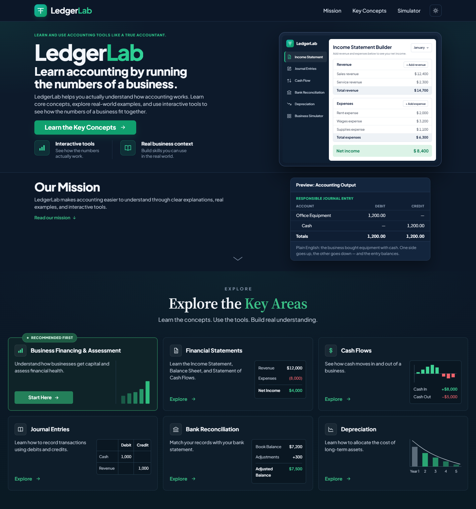
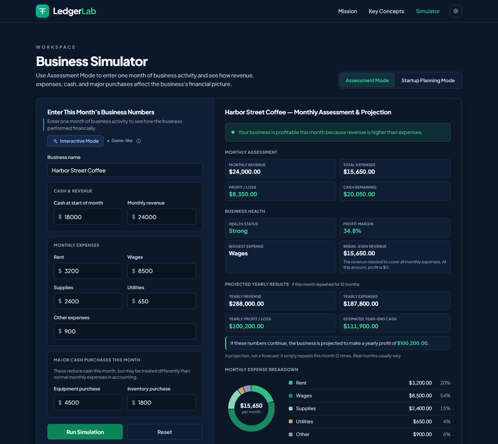
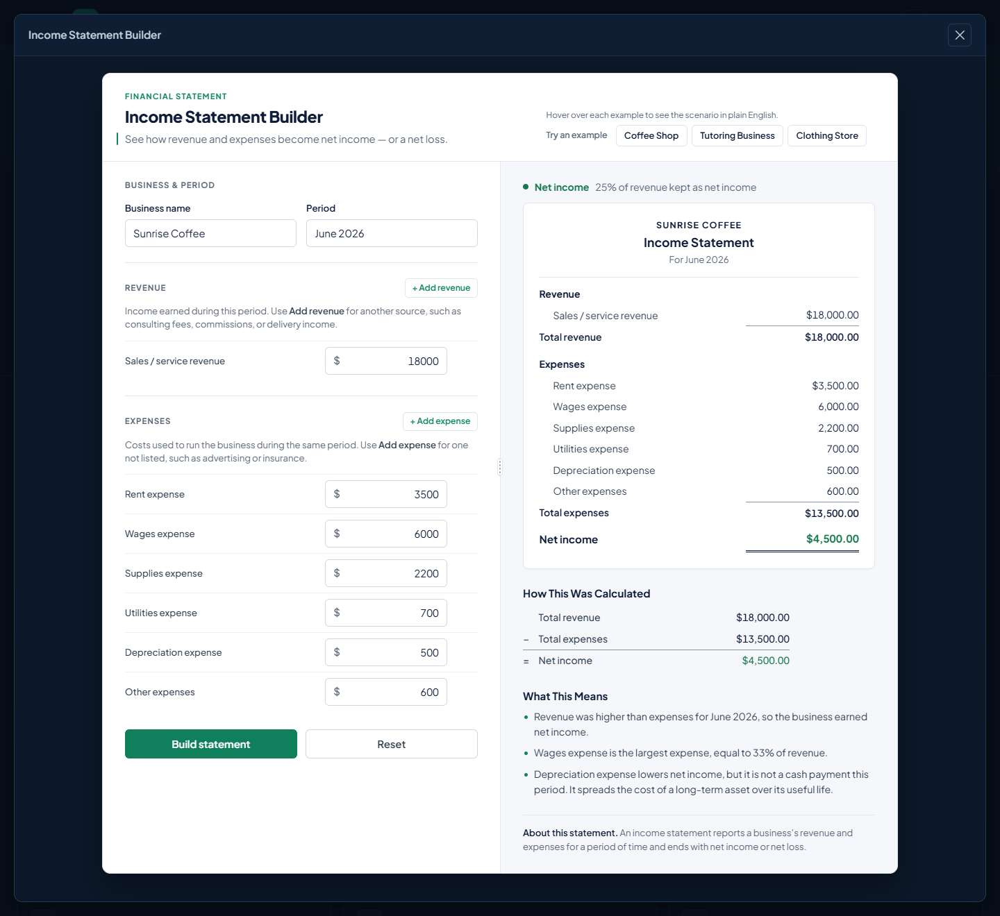
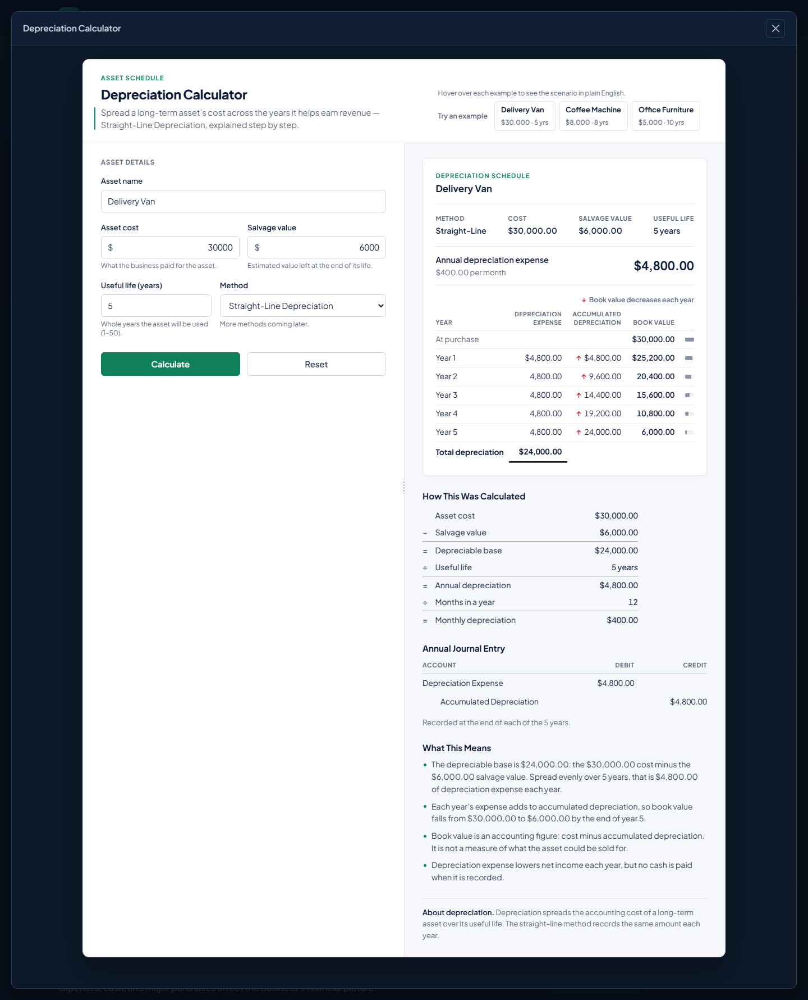

# LedgerLab

LedgerLab is an interactive accounting and business-finance learning toolkit.
It teaches accounting by having you work with the numbers of a business and
showing the results the way an accountant would present them.

**Live Demo:** [ledgerlab-eight.vercel.app](https://ledgerlab-eight.vercel.app)

---

## Overview

Accounting is often taught through definitions and rules that are hard to
connect to a real business. LedgerLab works the other way around. You enter
realistic business numbers, such as a month of revenue and expenses, a startup
budget, a bank statement or an equipment purchase. LedgerLab then produces the
accounting output those numbers lead to, with a plain-English explanation of
what it means.

It is built for accounting students, beginners and new business owners who want
to see how the numbers fit together rather than memorize them.

## Features

### Business Simulator

The Simulator has two modes:

- **Business Assessment Mode:** enter one month of business activity (revenue,
  expenses, cash and major purchases) and review a monthly assessment, business
  health indicators, projected yearly results and a monthly expense breakdown.
- **Startup Planning Mode:** plan a new business's startup budget and review
  a plan at a glance, a typical monthly plan, monthly operating costs and how
  the startup cash is used.

Each mode supports two ways of entering data:

- **Standard form entry:** fill in all fields directly.
- **Interactive Mode (optional):** a guided flow that asks one question at a
  time, lets you review your answers and then runs the same assessment or plan.
  It reads from and writes to the same fields as the standard form, so you can
  switch between the two at any time.

Results come with accounting-style reports and explanations of what the numbers
mean for the business.

### Accounting Tools

There are five focused tools, each opened in its own workbench:

| Tool | What it does |
| --- | --- |
| **Bank Reconciliation** | Reconciles a bank statement balance with the book balance, accounting for timing differences, fees, interest and missing items. |
| **Journal Entry** | Builds the debit/credit entry for common business transactions and explains the effect on each account. |
| **Income Statement** | Builds a single-step income statement from revenue and expense lines, including custom line items. |
| **Cash Flow** | Classifies cash transactions into operating, investing and financing activities and builds a statement of cash flows. |
| **Straight-Line Depreciation** | Calculates annual depreciation for a long-term asset and produces a full schedule, the formula with your numbers and the yearly journal entry. |

### Built-in examples

Every tool includes ready-made examples, such as a coffee shop income statement,
a startup cash flow or a delivery van depreciation. Selecting one fills in the
inputs and immediately shows the result, so you can explore a tool before
entering your own numbers.

### Themes and layout

- Light and Dark themes, with the choice saved between visits
- Responsive layout for desktop and mobile

## Results Designed Like Accounting Workpapers

LedgerLab's outputs are laid out like the accounting documents they represent,
not as generic result cards. That way you learn to read the real format:

- **Income statement:** revenue, expenses and net income in statement form
- **General journal:** dated debit and credit lines with balanced totals
- **Bank reconciliation workpaper:** bank side and book side adjusted to a
  reconciled balance
- **Statement of cash flows:** operating, investing and financing sections with
  the net change in cash
- **Depreciation schedule:** year-by-year depreciation expense, accumulated
  depreciation and book value

Each output comes with a short explanation of what the numbers show.

## Technology

- HTML
- CSS
- JavaScript (no frameworks, no build step, no backend)
- Modular JavaScript calculation files for the accounting logic
- Node-based automated tests using Node's built-in `assert` module

## Architecture

```
index.html               Application structure and UI
styles.css               Design system, Light/Dark themes, responsive layout
script.js                UI controller: navigation, forms, Simulator, rendering

bank-reconciliation.js   Bank reconciliation calculations
cash-flow.js             Cash flow classification and statement totals
depreciation.js          Straight-line depreciation schedule
income-statement.js      Income statement totals and net income
journal-entry.js         Transactions, account effects and journal entries

tests/                   Unit tests for each calculation module and the
                         Startup Planning logic
```

The accounting rules are kept in separate calculation modules, apart from the
code that handles the page. Each module takes plain inputs and returns plain
results with no dependence on the DOM. The same file is loaded by the browser
and required directly by the Node tests. This separation makes the accounting
logic easier to test, reason about and change without affecting the UI.

## Testing

The project includes **82 passing unit tests** across six test files. They cover
the five calculation modules and the Startup Planning calculations in
`script.js`.

The tests use only Node's built-in `assert` module. Run them with:

```bash
for f in tests/*.test.js; do node "$f"; done
```

Or run a single file:

```bash
node tests/cash-flow.test.js
```

Beyond the unit tests, I tested the application extensively in the browser
during development. This covered every tool and its examples, a range of
Simulator scenarios in both modes and in Interactive Mode, both themes, and
desktop and mobile layouts.

## Running Locally

LedgerLab is a static site and needs no installation or build step.

- Open `index.html` directly in a browser, or
- Serve the folder locally, for example:

```bash
python -m http.server 8000
```

Then open <http://localhost:8000>.

## Development Approach

I defined LedgerLab's product direction, the accounting workflows each tool
should teach, the feature requirements, the UX and design decisions, and the
testing scenarios. I then refined the application through many rounds of
changes. AI coding tools were used extensively to speed up implementation.
I directed the requirements, reviewed the implementation and its behavior,
tested the application, and made the final product decisions.

## Screenshots

### Landing page

The hero section and the Key Areas that lead into the Simulator and each
accounting tool.



### Business Simulator: Assessment Mode

One month of activity for a sample coffee shop, with the monthly assessment,
business health indicators, yearly projection and expense breakdown.



### Income Statement Builder

The built-in Coffee Shop example: inputs on the left and the finished income
statement, calculation and explanation on the right.



### Straight-Line Depreciation

The built-in Delivery Van example, with the depreciation schedule, the formula
using the example's numbers and the annual journal entry.



---

_LedgerLab is an educational project and does not provide professional
financial or accounting advice._
